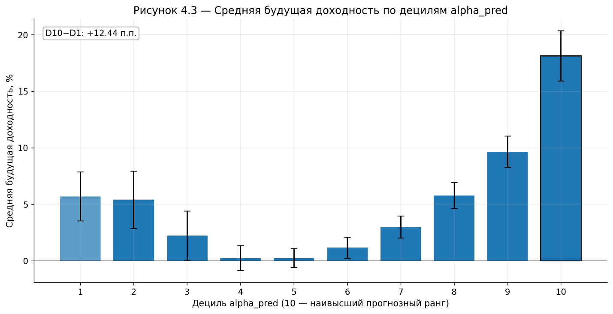
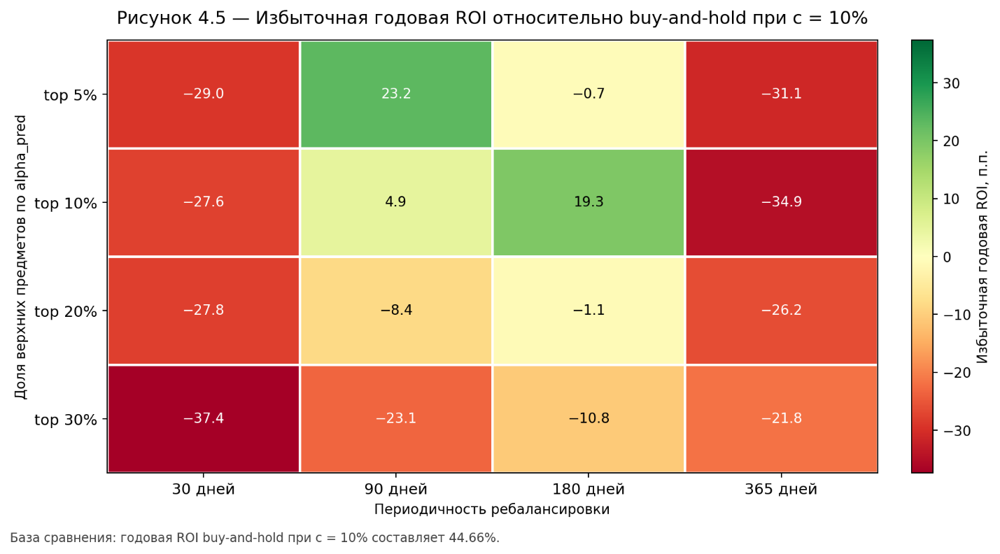

# cs2 market research

can machine learning help identify promising items in the counter-strike market, even after accounting for trading costs?

this repository brings together the code and selected results from my 2026 bachelor's thesis. i wanted to explore cs2 items as a market of digital assets, rather than try to predict the price of any single skin.

## approach

the research combines a market-regime model with cross-sectional item ranking. predictions are used to construct long-only portfolios and compared with a passive buy-and-hold benchmark.

the workflow covers:

- historical prices, trading volumes, and item attributes
- a changing pool of items filtered by liquidity and trading activity
- gradient-boosted models for market conditions and relative item performance
- portfolio simulations with holding restrictions and transaction costs
- comparisons across portfolio sizes and rebalancing intervals

## selected results

the thesis reports the following **full-window historical backtests** at an assumed 10% selling cost:

| strategy | simulated total return |
| --- | ---: |
| buy and hold | 138.2% |
| top 5% of ranked items, rebalanced every 90 days | 237.7% |
| top 10% of ranked items, rebalanced every 180 days | 219.9% |

these figures describe historical simulations, not live trading or independent out-of-sample performance. the test-period results are available separately in [`results/tables/strategies_test_only_10pct.csv`](results/tables/strategies_test_only_10pct.csv). shorter rebalancing intervals were particularly sensitive to fees.

## repository

- [`scripts/`](scripts/) — data preparation, modeling, backtesting, and analysis
- [`src/`](src/cs2_trading_rebuild/) — supporting python modules
- [`configs/`](configs/) — research configuration
- [`results/`](results/) — selected figures, tables, and historical simulation outputs
- [`docs/research-notes.md`](docs/research-notes.md) — methodology and interpretation
- [`docs/reproducing.md`](docs/reproducing.md) — data requirements and original script sequence

the original market database is not included. all returns shown here are modeled historical outcomes, not trading recommendations.
